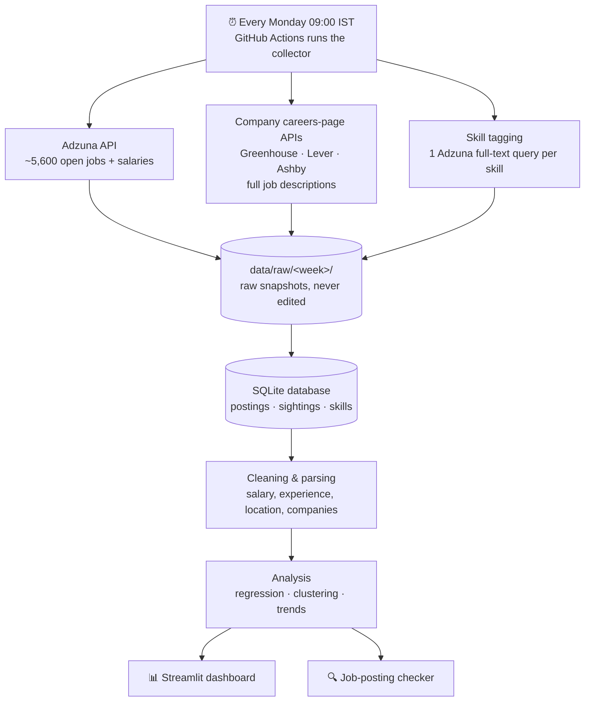

# WorkForce AI: Data Analyst Job Market Intelligence (India)    

**Which skills actually matter for a data analyst job in India, and which ones pay more?**
We're answering that with real data: thousands of live job postings, collected
between 27 Sep and 1 Oct 2026, then analysed statistically.

> **Status: collection FROZEN on 4 Oct 2026 (D33).** The weekly schedule and the
> API keys have been removed. The data, analysis and website stay as they are.

*Built by Dipayan & Sayak · Data collection started 27 Sep 2026*

### 🌐 Website: **[dipayan8k.github.io/workforce-ai-dashboard](https://dipayan8k.github.io/workforce-ai-dashboard/)**
*Backup dashboard: [workforce-ai-india.streamlit.app](https://workforce-ai-india.streamlit.app)*

---

## 🎯 The problem

Anyone preparing for data analyst roles hits the same questions:
*Power BI or Tableau? Is Python really required? Does knowing machine learning
get you paid more, or is SQL + Excel enough?*

The usual answers are opinions, course ads, or blog posts that are years old.
We wanted **evidence from the current Indian job market**. And because the
market moves, we wanted to measure **how it changes week to week**, not
just take a single snapshot.

## 📦 What we're building

A pipeline that tracks every open data-analyst-type job posting in India each
week, and a **dashboard** that answers four questions:

| Question | Method |
|---|---|
| **1. Which skills are most in demand?** | Frequency of each skill across postings |
| **2. Which skills go with higher salaries, and by how much?** | Regression on employer-advertised salaries |
| **3. Do different kinds of companies hire for different skill sets?** | Clustering companies by what they ask for |
| **4. Which skills are rising or fading?** | Run-over-run trends, which grow with every new collection run |

For question 3, our hypothesis is that IT-services firms want breadth across
many tools while product companies want SQL depth, one viz tool and
stakeholder communication. That's a hypothesis to **test** against the data,
not an assumption built into the analysis.

**Bonus:** a *job-posting checker*. Paste in any job description and see how
it compares to the market: which salary cluster it's closest to, and whether
its required skills are rising or fading.

**The outcome** is a concrete, defensible statement like:
> *"Across N postings since September 2026, jobs asking for skill X advertised
> a Y% higher salary band, controlling for other skills, so that's the skill
> I prioritized."*

Demand, salary and company-pattern results come from the large snapshot
already collected. Trends grow with every additional collection run, which
can be triggered on demand from GitHub (*Actions → Weekly job collection →
Run workflow*).

---

## 🔄 How it works



1. **Collect**: a scheduled GitHub Actions job (every Monday, until the
   freeze on 4 Oct 2026) pulled all open postings for 10 analyst-related job
   titles in India and committed each snapshot to this repo.
2. **Store raw**: each week is saved exactly as received, in its own folder.
   The raw files are the source of truth, so if we improve a cleaning rule
   later, we re-run it over every past week.
3. **Load into SQL**: all weeks are loaded into one SQLite database, designed
   so the same posting seen in several weeks is stored once. A `sightings`
   table records *which week saw which posting*, and that table is the
   time dimension.
4. **Clean & extract**: salaries, experience level, location, and company
   names (merging duplicates like "Amazon" and "ADCI – Karnataka").
5. **Analyse**: regression, clustering and trends (scikit-learn, pandas).
6. **Present**: an interactive Streamlit dashboard.

---

## 🔍 What we've found so far

*Week 1 only (27 Sep 2026), so these are early observations, not conclusions.*

- **5,671 open postings** from **1,827 companies**. The largest hirers are
  Amazon, Accenture, Genpact, Amgen, EXL, Citi and PwC. Most jobs are in
  Karnataka, Maharashtra and Telangana.
- **Only 15% of postings list a salary**, so the salary analysis rests on a
  few hundred postings. Every result will be reported with its sample size.
- **A pipeline-breaking problem, caught in week 1:** our main source returns
  only the first 500 characters of each description. Measured on
  analyst-titled postings, **SQL appeared in 5.7% of those snippets but in
  60.5% of full descriptions**, because the skills list is usually in the
  cut-off part. Salaries existed only in the truncated source and full text
  only in the no-salary source, so almost no posting had both.
  **Fix:** Adzuna *searches* the full text even though it only *returns* 500
  characters. So we ask it one question per skill ("which Data Analyst jobs
  mention SQL?"). That gives SQL in **68%** of Data Analyst postings,
  consistent with the full-text sample, and every salaried posting gets its
  real skill list.
- **Real-world mess to handle:** "open" postings dating back to 2019,
  impossible salaries (₹78/year), anonymous employers listed as "MNC", and
  one company under several names.

---

## 🧭 Key decisions

Every choice that shapes the results is logged with its reasoning in
**[DECISIONS.md](DECISIONS.md)**. Highlights:

- **Official APIs, not scraping.** Naukri, Indeed and LinkedIn prohibit
  automated scraping. We use the Adzuna API and companies' public job-board
  APIs, so the data is legitimate and the pipeline doesn't break mid-study.
- **Collect every open posting each week, not just new ones.** This keeps
  both views available: what's new, and what stays open for weeks.
- **Only employer-advertised salaries** go into the regression, never
  estimated ones.
- **Collect broad, filter later.** We can always exclude postings, but we
  can't go back in time and collect a week we missed.
- **14 tracked skills:** SQL, Excel, Python · Power BI, Tableau ·
  statistics, A/B testing, machine learning · ETL, AWS, Azure · stakeholder
  management, communication · generative AI / LLMs.
- **Working within an API budget.** The free tier allows 250 calls a day, so
  collection and skill tagging are designed to fit (~130 + ~25 calls per week).

---

## 🛠️ Tech stack

| Layer | Tools |
|---|---|
| Language | Python |
| Data collection | `requests`, Adzuna API, Greenhouse / Lever / Ashby job-board APIs |
| Automation | GitHub Actions (weekly cron) |
| Storage | Compressed JSON Lines (raw layer) → SQLite (queryable layer) |
| Cleaning | pandas |
| Analysis | scikit-learn (regression, clustering) |
| Dashboard | Streamlit |
| Collaboration | Git, GitHub |

---

## 📅 Status

| Phase | What | Status |
|---|---|---|
| 1 | Collection (Adzuna + company job boards) | ✅ Weekly while building, then on demand |
| 2 | SQL database + skill tagging | ✅ Done |
| 3 | Cleaning & parsing: salary, experience, location, companies | ✅ Done |
| 4 | Analysis: skill demand, salary regression, job-type clustering, company comparison | 🔄 Preview done; final after last data run |
| 5 | Dashboard (Streamlit, 11 pages) | ✅ [Live](https://workforce-ai-india.streamlit.app), preview data; final numbers after the last data run |
| 6 | Bonus: job-posting checker | ⏳ |

---

## 📁 Project structure

```
collector/                  ← gets the data
  config.py                 ← WHAT we collect: job titles, skills, companies, limits (edit this one)
  run_collection.py         ← one weekly run, the script GitHub Actions calls
  adzuna.py                 ← Adzuna API: paginated, rate-limited, deduplicated
  adzuna_skills.py          ← skill tagging via Adzuna's full-text search
  ats.py                    ← company job boards (Greenhouse / Lever / Ashby)
  storage.py                ← saves raw snapshots
  http_client.py            ← shared HTTP session with automatic retries
database/                   ← makes the data queryable
  schema.sql                ← table design, with comments explaining each table
  build_db.py               ← rebuilds data/workforce.db from all raw snapshots
  example_queries.sql       ← a guided SQL tour of the data, simple → advanced
data/raw/<run_id>/          ← one folder per weekly run (raw, never edited)
.github/workflows/          ← (removed at the freeze, D33)
cleaning/                   ← turns raw postings into analysis-ready rows (Phase 3)
  clean.py                  ← salary, experience, city, company rules → table postings_clean
  company_aliases.csv       ← which company names are the same company (editable)
  company_types.csv         ← company type labels for the top companies (editable)
analysis/                   ← answers the questions (Phase 4)
  run_all.py                ← runs everything, writes results/
  demand.py                 ← which skills are asked for most
  salary.py                 ← which skills go with higher pay (regression + checks)
  clusters.py               ← the 6 types of Data Analyst jobs (k-means)
  companies.py              ← do company types hire differently?
  rebuild.py                ← ONE command: database → cleaning → analysis, in the right order
  market.py                 ← cities, salary, skill combinations, freshness, AI & work mode, explorer
results/                    ← aggregated results only (safe to publish); read by the dashboard
site/                       ← the premium website (GitHub Pages): 8 pages, reads results/ only
  build_data.py             ← bundles results/ into one data.json for the site
dashboard/
  app.py                    ← the Streamlit backup dashboard (reads results/ only)
DECISIONS.md                ← every decision and why
```

---

## ▶️ Running it yourself

You **don't need API keys** to explore the data: everything collected is
already in `data/raw/`. (Collection is frozen; new runs would need new keys.)

**Setup (once):**

Mac:
```bash
python3 -m venv .venv
source .venv/bin/activate
pip install -r requirements.txt
```
Windows:
```bash
python -m venv .venv
.venv\Scripts\activate
pip install -r requirements.txt
```

**Build the database and explore:**
```bash
python -m analysis.rebuild          # database → cleaning → analysis, in order
streamlit run dashboard/app.py      # opens the dashboard in your browser
```
Then open `data/workforce.db` in [DB Browser for SQLite](https://sqlitebrowser.org)
(free, easiest), or on Mac:
```bash
sqlite3 -box data/workforce.db < database/example_queries.sql
```

**Collecting data yourself** (needs free keys from developer.adzuna.com in a
`.env` file; see `.env.example`):
```bash
python -m collector.run_collection --probe   # how many postings match each search term
python -m collector.run_collection           # a full weekly run
```

### 🤝 Working together
- **Always pull before you start** (GitHub Desktop: *Fetch origin → Pull
  origin*) and **push when you're done**. Every Monday the robot adds a new
  week of data.
- **Changing what we collect?** Edit `collector/config.py` **and** add an entry
  to `DECISIONS.md`. Changing the search mid-study changes what the trend
  lines mean.
- **Never commit `.env`.** It holds the API keys (git already ignores it).

---

## 💰 Cost safety: this project must always cost ₹0

| Service | Plan | Free limit | Our usage |
|---|---|---|---|
| Adzuna API | Free, "Personal research" (no time limit) | 250 calls/day, 2,500/month | ~161 on Mondays, ~700/month |
| GitHub Actions | Free (private repo) | 2,000 minutes/month | ~52 minutes/month |
| Company job boards | Public, no account | – | ~25 requests/week |

**Rules:**
1. **Never add a credit card** to any account this project uses. Without a
   card, the worst case is that something stops working for a day. Never a bill.
2. **Never commit `.env`** or paste API keys anywhere. Keys live only in
   `.env` (git-ignored) and GitHub Secrets.
3. **Before adding any new service** (hosting, APIs, libraries), check:
   can it cost money? Does it ask for a card? What are the free limits?
4. Each run is hard-capped at 200 Adzuna calls in code (`collector/config.py`).

Licence details: [DECISIONS.md](DECISIONS.md), D11.

**Shut down on 4 Oct 2026 (D33):**
1. ✅ Weekly workflow file deleted (`.github/workflows/weekly_collect.yml`).
2. ✅ `.env` (the keys) deleted from the computer.
3. GitHub → *Settings → Secrets and variables → Actions*: delete `ADZUNA_APP_ID` and `ADZUNA_APP_KEY`.
4. Optional: email info@adzuna.com asking to close the API account.

The code and results stay on GitHub; only the connection to Adzuna is cut.

---

## 📜 Data sources & credit

- Job and salary data: **Jobs by [Adzuna](https://www.adzuna.in)**, used for
  personal research under the Adzuna API terms. Individual listings are not
  republished; only aggregated results will be shared.
- Company job boards via the public Greenhouse, Lever and Ashby job-board APIs.
- Naukri, Indeed and LinkedIn are intentionally **not** scraped: their terms
  of service prohibit it.
